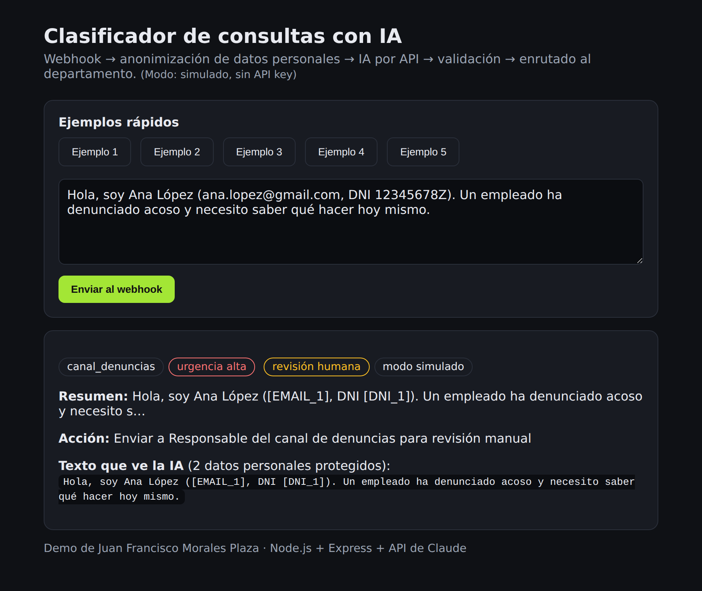

# Clasificador de consultas con IA

Demo de **automatización con IA integrada por API**. Un webhook recibe consultas de clientes (como las que llegan a una consultora de protección de datos). Antes de enviarlas a un modelo de IA (Claude), **anonimiza los datos personales**. Después la IA las clasifica, el sistema **valida la respuesta** y las envía al departamento correcto.



## Qué problema resuelve

Hoy alguien lee cada email o formulario y lo reparte a mano. Con este flujo:

1. Llega la consulta a un **webhook** (`POST /webhook/consulta`).
2. Se **seudonimizan** email, DNI/NIE, teléfono e IBAN: `ana@gmail.com` pasa a ser `[EMAIL_1]`. La IA nunca ve el dato real.
3. Se llama a la **API de Claude** con instrucciones claras y se le pide la respuesta **en JSON**.
4. Se **valida** el JSON: categoría y urgencia permitidas, resumen, y si requiere revisión humana.
5. Se ejecuta la **acción**: se asigna automáticamente o, si el caso es delicado, pasa a **revisión humana**.

```
Formulario / email ──► Webhook ──► Anonimizar ──► API de IA ──► Validar JSON ──► Enrutar al departamento
                                                     │
                                          si falla ──┴──► reintentos ──► revisión humana (fallback)
```

## Decisiones técnicas

| Decisión | Por qué |
|---|---|
| API key solo en el servidor (`.env`) | Si estuviera en el frontend, cualquiera podría verla y gastar a tu cuenta. |
| Anonimizar antes de enviar | RGPD: minimización de datos. El proveedor externo solo recibe lo imprescindible. |
| Salida en JSON + validación | El modelo puede equivocarse o inventar una categoría. Nunca se usa su respuesta sin comprobarla. |
| `max_tokens` limitado | Controla la longitud y el **coste** de cada llamada. |
| Timeout + reintentos con espera exponencial | La API puede tardar o devolver 429/5xx (errores temporales). Los 400/401 no se reintentan. |
| Fallback a revisión humana | Si la IA falla, la consulta no se pierde. |
| Humano en el bucle para casos delicados | Denuncias, brechas o plazos legales siempre los revisa una persona. |
| Registro solo con texto anonimizado | Trazabilidad sin almacenar más datos personales de los necesarios. |

**Limitación conocida:** los **nombres propios** no se detectan con expresiones regulares. En producción usaría una librería de reconocimiento de entidades (NER) o un modelo desplegado en la UE para esa fase.

## Cómo ejecutarlo

```bash
npm install
cp .env.example .env     # opcional: añade tu ANTHROPIC_API_KEY
npm start                # http://localhost:3000
npm test                 # tests de anonimización y validación
```

Sin API key funciona en **modo simulado**, con reglas simples, para enseñar el flujo completo. Con API key usa la IA real.

Probar el webhook desde la terminal:

```bash
curl -X POST http://localhost:3000/webhook/consulta \
  -H "content-type: application/json" \
  -d '{"mensaje":"Hemos sufrido una brecha de datos esta mañana, mi email es ana@empresa.es"}'
```

## Estructura

```
src/server.js      Express: webhook, enrutado y registro
src/anonimizar.js  Seudonimización de datos personales (y restaurar)
src/ia.js          Llamada a la API de Claude, reintentos, timeout, fallback y modo simulado
src/validar.js     Extracción y validación del JSON de la IA
public/index.html  Interfaz para probar la demo
tests/             Tests con node:test
```

## Posibles mejoras

- Guardar el registro en PostgreSQL y crear tickets en la herramienta interna.
- Validación con esquema (Zod) y *structured outputs* del proveedor.
- Cola de mensajes para procesar picos de consultas sin saturar la API.
- Proveedor con región UE (por ejemplo, Google Cloud Vertex AI) y acuerdo de tratamiento de datos.

---
Juan Francisco Morales Plaza · [Portfolio](https://juanfranciscomp30.github.io/portfolio-juanfrancisco/)
